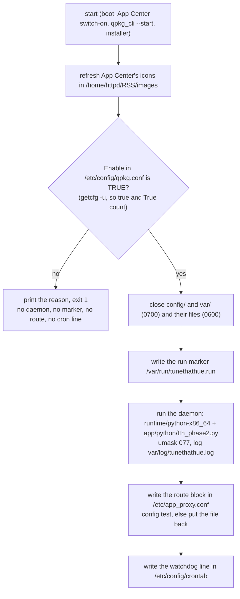

# TuneThatHue on a QNAP NAS: the service

The package's service script is [`qnap/shared/tunethathue.sh`](../qnap/shared/tunethathue.sh).
QTS runs it as root through `/etc/init.d/tunethathue.sh`, a link QTS makes for every installed
package at installation and at every boot:

- at every boot, for every installed package, switched off or not (`/etc/rcS.d/QS<n>TuneThatHue start`);
- from App Center's on/off switch (`qpkg_cli --enable` runs `start`, `qpkg_cli --disable` runs `stop`);
- from `qpkg_cli --start` and `--stop`;
- from the installer: the old version's `stop` before an upgrade, the new version's `start` after it;
- from the uninstaller: `stop`, then `remove`.

An explorable picture of the same lifecycle:
[`docs/diagrams/qnap-service-lifecycle.html`](diagrams/qnap-service-lifecycle.html)
(source: `qnap-service-lifecycle.json`, made with the archify tool).

## start

`restart` is `stop` followed by `start`, so a switched-off package stops and stays stopped.
`start`, `stop` and `restart` take a lock (`var/run/service.lock`) and wait for it up to 30
seconds.

## stop

1. Removes the run marker first. A watchdog run that comes after this starts nothing.
2. Removes the watchdog line from `/etc/config/crontab` and the route block from
   `/etc/app_proxy.conf`, then reloads the panel's Apache if its config test passes.
3. Ends the daemon of this installation only: a process whose `/proc/<pid>/exe` is the same
   file as the bundled `python3` and whose command line runs `tth_phase2.py`. The file
   comparison (`-ef`) holds on QuTS hero too, where one folder has two names
   (`/share/ZFS2_DATA/...` from `Install_Path`, `/share/ZFS530_DATA/...` as the process sees it).
   SIGTERM, ten seconds, then SIGKILL.

`stop` leaves Enable as it is: App Center's switch writes it, `qpkg_cli --stop` does not.

## The watchdog

The cron line runs `tunethathue.sh watchdog` every two minutes. It does nothing when the lock
is taken, when `Status` in qpkg.conf is not `complete` (an installation is replacing the
files), or when the run marker is missing (`stop` ran, or `start` has not run since the NAS
booted; `/var/run` is cleared at boot). When Enable is not TRUE it removes its own cron line
and the marker. Otherwise it cuts the log when it is over 8 MiB (the last 1 MiB goes to
`tunethathue.log.1`; the daemon writes a stats line a second), puts the route block back if
QTS dropped it, and starts the daemon again if it is not running.

## The panel route

The daemon serves its page on port 58091 (`Web_Port`). The panel's Apache includes
`/etc/app_proxy.conf`, and two rules there send `/TuneThatHue/` to that port:

- QTS's own line, written for a package with `Use_Proxy = 1`:
  `ProxyPass "<Proxy_Path>" "http://127.0.0.1:<Web_Port>/" retry=0`. App Center's Open goes
  to `<Proxy_Path>` (the `webUI` that `appRequest.cgi` reports is `/TuneThatHue/`).
- The script's block, between `# >>> TuneThatHue (managed by tunethathue.sh) >>>` and
  `# <<< TuneThatHue <<<`: a redirect of the bare `/TuneThatHue` to `/TuneThatHue/`, the
  `X-Forwarded-*` headers, `ProxyPass` and `ProxyPassReverse`.

`Proxy_Path` is `/TuneThatHue/` with the slash, so both rules map the same way and their order
in the file does not matter. QTS writes its line above the block after every switch-on in App
Center. With the old `Proxy_Path` (`/TuneThatHue`, up to 0.9.9) that line sent
`/TuneThatHue/api/status` to the daemon as `//api/status`, and the daemon answered 404. The
script removes a line of that old form when it finds one.

## Files outside the package folder

| Path | Made by | Removed by |
| --- | --- | --- |
| `/var/run/tunethathue.run` | `start` | `stop`, the watchdog when Enable is not TRUE, `PKG_POST_REMOVE` |
| block in `/etc/app_proxy.conf` | `start`, the watchdog | `stop`, `PKG_POST_REMOVE` |
| line in `/etc/config/crontab` | `start` | `stop`, the watchdog when Enable is not TRUE, `pkg_post_install`, `PKG_POST_REMOVE` |
| `/home/httpd/RSS/images/TuneThatHue*.gif` | QTS at installation; `start` refreshes them | QTS's uninstaller |

The package puts nothing in `/usr/bin`, `/usr/sbin` or `/usr/local/bin`. A command for a
person to type is `/etc/init.d/tunethathue.sh start|stop|restart|status`.

## Files inside the package folder

QTS runs package scripts with umask 0000 (QuTS hero: 0022). The script runs with umask 077, so
everything the daemon writes is private, and every `start` closes `config/` and `var/` (0700)
and the files in `config/` and `var/log/` (0600). `config/hue-box.toml` holds the paired
bridge's application key and client key. `pkg_post_install` closes the same folders after an
upgrade, also for a package that stays switched off.

Up to 0.9.9, `stop` rewrote `/etc/config/crontab` through a temporary file in `/tmp` that it
moved over the crontab. Under QTS's umask 0000 that left root's crontab writable by every
user (0666). `pkg_post_install` and every crontab edit of the script set it back to the
firmware's 0644 (`chmod go-w`).

## Updates

The package is in two feeds on qnaputilities.com, `repo.xml` (App Center's repository) and
`sdlv.xml`, both made from `pub.qnaputilities.com/tunethathue/download/`. QTS records which
feed installed a package as `store` in qpkg.conf; the value is the MD5 of the feed's URL
(`71440c3a…` for `https://www.qnaputilities.com/repo.xml`, `9d20878e…` for `sdlv.xml`). An
update from a feed (`qpkg_cli -a TuneThatHue -x <store>`, what App Center does) is refused
while the installed package belongs to another store ("The internal name of TuneThatHue has
been registered by TuneThatHue"). `qpkg_cli -m <file>` installs over any of them and keeps the
`store` value and the settings.

## Upgrades from 0.9.9 and older

`pkg_post_install` deletes what the old versions left: `app.new/`, `app.prev/` and
`etc/tunethathue/daemon.sh` (its job is in `tunethathue.sh` now), and the old watchdog line
that called it. Settings in `config/` are kept.
